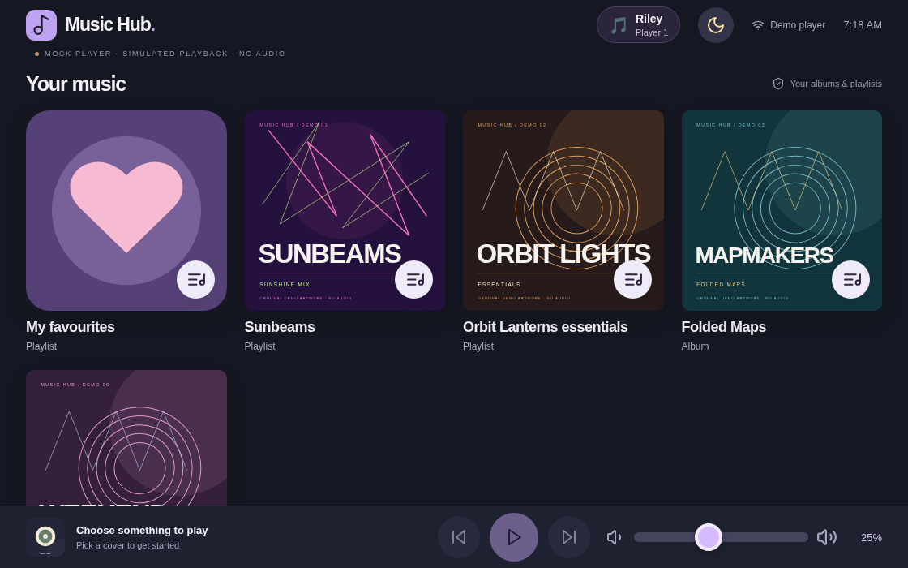
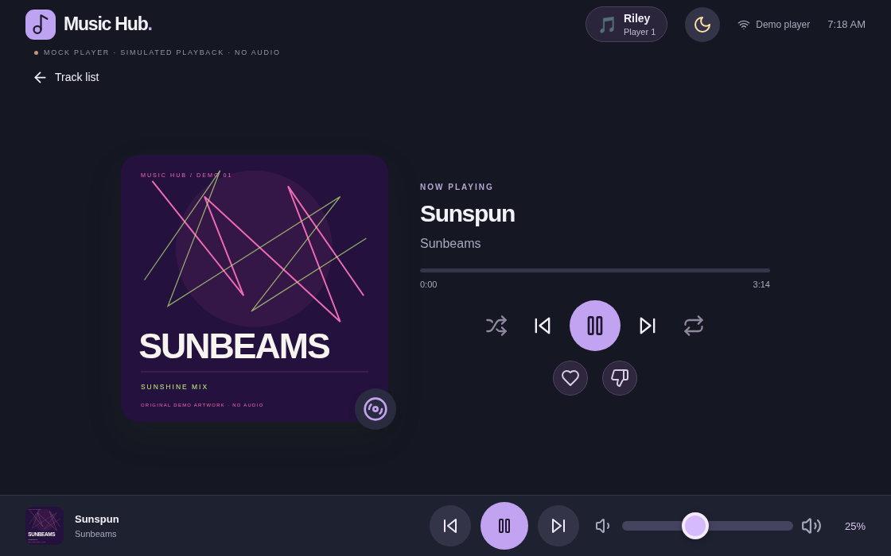
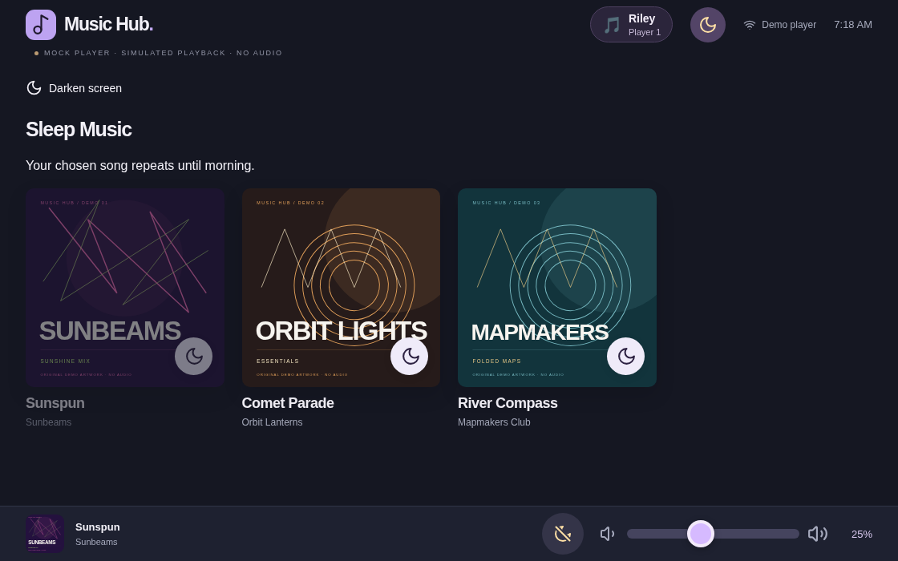
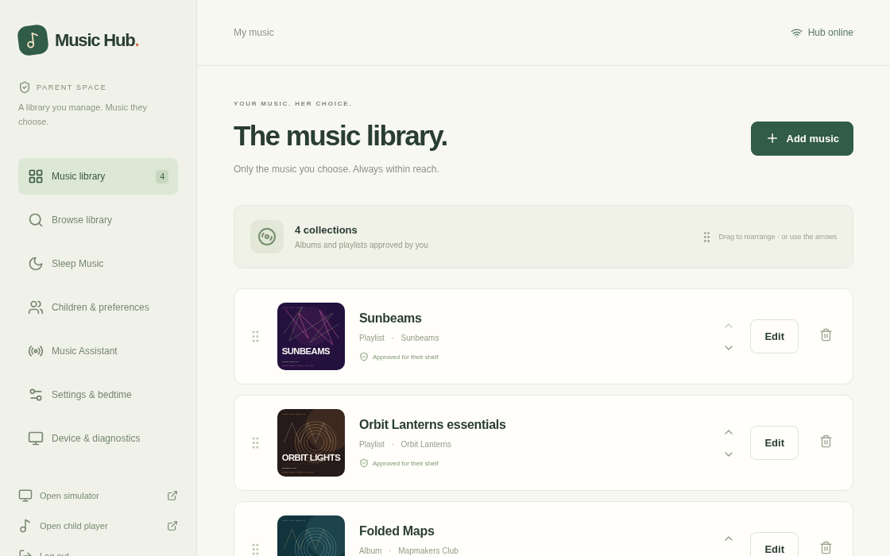

# Kids Music Box

A self-hosted jukebox for children. Parents approve albums, playlists and songs. Children browse a picture-first library, play music on a paired browser or tablet, and choose a song to repeat at bedtime.



- **Parent controls** for music approvals, profiles, volume limits and bedtime schedules.
- **Child controls** for browsing, playback, favourites and Sleep Music. A crossed-out moon next to the volume slider stops an active Sleep Music session.
- **Real playback** through Music Assistant, with optional voice search and Fully Kiosk integration.

## Try the demo

You need Docker and Docker Compose. The demo uses a fictional catalogue and simulates playback silently.

```sh
git clone https://github.com/bradis86/kidsmusicbox.git
cd kidsmusicbox
docker compose up --build -d
docker compose logs kids-music-hub
```

1. Open [Parent controls](http://localhost:3210/admin). Enter the first-run setup code from the local logs and create a parent password.
2. Open **Browse library**, inspect the available tracks, and approve some music.
3. In **Settings & bedtime**, choose **Pair this browser**. Open the [child player](http://localhost:3210/child) in the same browser.
4. To try bedtime playback, add a song to **Sleep Music** from its track preview in **Browse library**. Open the moon button on the child player to choose a song.

The Compose service binds to loopback by default and keeps its data in a named volume. Run `docker compose down` to stop the demo.

## Screenshots

| Now Playing                                                                                             | Sleep Music                                                                                        | Parent approvals                                                                     |
| ------------------------------------------------------------------------------------------------------- | -------------------------------------------------------------------------------------------------- | ------------------------------------------------------------------------------------ |
|  |  |  |

## Run it with your music

See [Music Assistant setup](docs/music-assistant.md), [architecture](docs/architecture.md), [Home Assistant automation](docs/home-assistant.md), and [development and testing](docs/development.md).
