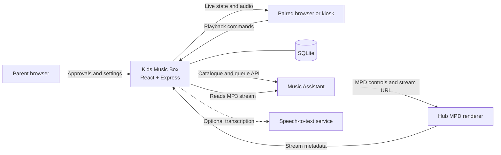
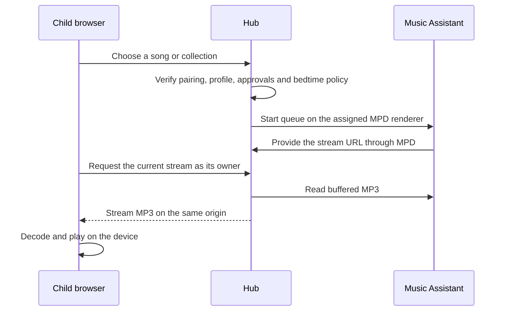

# Architecture

The React client and Express API share an origin. SQLite stores account state, pairing, profiles, approvals and preferences. The mock adapter simulates catalogue and player state. The Music Assistant adapter uses the same hub policy and streams real audio.

## Playback sequence

Sleep Music queues one repeating approved song and uses a separate cutoff. The screen schedule is independent of the audio queue. Fully Kiosk can expose Android backlight and media volume controls to the paired child page.

See [API and trust boundaries](api.md) and [Music Assistant setup](music-assistant.md).
